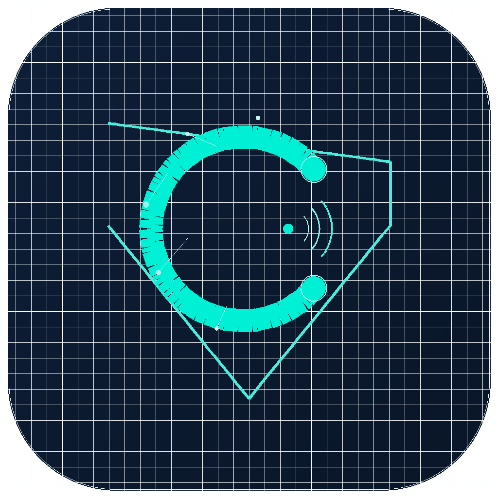

<div align="center">



# Covert

**Advanced HTTP/HTTPS MitM Proxy Debugger & API Client**

*Created by Sharodshahi Al-Amin · [Undercover IT Firm](https://undercoveritfirm.com)*

[](https://github.com/savaskarofficial/covert)
[](https://github.com/savaskarofficial/covert)
[](https://github.com/savaskarofficial/covert)
[](LICENSE)

---

**Covert** combines the power of **Charles Proxy**, **Fiddler**, and **Postman** into a single cross-platform app — traffic capture, API testing, request rewriting, breakpoints, scripting, and 25-language code generation, all in one place.

[Download](#download) · [Features](#features) · [Architecture](#architecture) · [Build](#build) · [Comparison](#comparison)

</div>

---

## Features

### Traffic Capture & MitM Proxy

- **Full HTTPS interception** with automatic CA certificate generation and one-tap installation
- **HTTP/2 frame-level MitM** — HPACK header decoding, stream multiplexing, not just byte piping
- **WebSocket** capture with real-time frame display and standalone WebSocket client
- **Protocol support:** HTTP/1.x, HTTP/2, HTTPS (TLS 1.1–1.3), SOCKS4/4a/5
- **Compression:** gzip, deflate, brotli (pure Dart), zstd (native FFI) — auto-detect by magic bytes
- **VPN mode** on Android — captures all traffic without Wi-Fi proxy configuration
- **System proxy** auto-configuration on Windows, macOS, Linux
- **Per-app filtering** on Android — choose which apps route through the proxy
- **SSL bypass** list — skip TLS inspection for pinned/sensitive hosts

### API Client

- **HTTP/1.1** via `dart:io HttpClient`
- **HTTP/2** via native ALPN (`package:http2`)
- **HTTP/3 (QUIC)** via Cronet on Android, H2 fallback on desktop
- **Tabbed interface** with multiple concurrent requests
- **Environment variables** with `{{variable}}` syntax — isolated per environment, global fallback
- **Collections** with folder organization, import from Postman
- **8 auth types:** Bearer, Basic, Digest (with 401 auto-retry), NTLM, API Key, OAuth 2.0 (interactive browser flow), AWS SigV4
- **Body types:** JSON, XML, Form Data, URL Encoded, Binary upload, GraphQL
- **Pre-request & post-response scripting** (JavaScript DSL)
- **Cookie manager** with auto-save across requests
- **Response viewer:** Auto/JSON/Protobuf/Raw/HEX tabs with syntax highlighting, image preview, search

### Code Snippets — 25 Languages

Generate ready-to-run code from any request, with full settings support (SSL, timeout, proxy, redirect):

| Language | Libraries |
|---|---|
| **Shell** | cURL |
| **C** | libcurl |
| **C#** | HttpClient, RestSharp |
| **Dart** | Dio, http (IOClient) |
| **Go** | net/http |
| **Java** | OkHttp, HttpClient, Unirest |
| **JavaScript** | Axios, Fetch, jQuery, XHR |
| **Kotlin** | OkHttp |
| **Node.js** | Axios, Fetch, Native http/https, Request |
| **PHP** | cURL, Guzzle |
| **Python** | Requests, http.client |
| **Ruby** | Net::HTTP |
| **Swift** | URLSession |

**Snippet Converter:** Paste code in any of 13 source languages → extract request → convert to any of the 25 output languages. No other proxy tool offers this.

### Rule Engine — 9 Categories

| Rule | Description |
|---|---|
| **Rewrite** | Modify URL, request/response headers, request/response body (regex) |
| **Gateway** | Block requests (custom status + body) or suspend |
| **Mirror** | Duplicate traffic to a secondary host — full response captured and shown in traffic list |
| **Map Local** | Serve local files as response (JSON, HTML, JS, XML) |
| **Map Remote** | Redirect requests to different URL (regex capture groups) |
| **Highlight** | Color-tag matching traffic for visual filtering |
| **Network Condition** | Throttle bandwidth, add latency, simulate packet loss (presets: Offline, 2G, 3G, 4G) |
| **Breakpoint** | Pause request and/or response for manual inspection and editing |
| **DNS Override** | Route traffic to custom IP without modifying the request (works on HTTPS CONNECT) |

Each rule supports: 11 match fields × 8 operators, AND/OR logic, priority ordering, drag-to-reorder, enable/disable toggle, JSON import/export.

### Mock Server

- Shelf-based HTTP server on configurable port
- Route matching with `:param` wildcards
- Response body editor, custom headers, status codes
- Artificial delay, priority ordering
- CORS auto-headers
- Request hit count tracking and logging
- Mobile-responsive layout

### Toolbox — 14 Tools

Base64 encoder/decoder, URL codec, MD5/SHA hash generator, JSON formatter, XML formatter, HEX viewer, Image viewer, JWT decoder, QR code generator, Regex tester, Timestamp converter, Response diff viewer, Random data generator, Color picker

### Collaboration

- **QR code pairing** for mobile ↔ desktop traffic forwarding
- **Real-time sync** — traffic streams between devices

### Breakpoint Editor

Full overlay editor when a breakpoint fires — edit request headers, body, URL, method before forwarding. Edit response headers, body, status code before returning to client. Resume, drop, or abort all.

### History & Favorites

- All traffic persisted to SQLite — survives app restart
- Bookmark requests — accessible even after clearing live traffic
- History grouped by capture sessions with date/time, request count, data volume
- Swipe-to-remove favorites

### HAR Import/Export

- Export traffic to standard `.har` format
- Import `.har` files — double-click on Windows, tap on Android
- File association registered in Windows installer and Android manifest

---

## Architecture

```
┌──────────────────────────────────────────────────────────────┐
│                        Covert Engine                          │
├──────────────────────────────────────────────────────────────┤
│                                                               │
│  Client ──TLS──▶ MitM Proxy (Isolate)                        │
│                       │                                       │
│               ALPN negotiation                                │
│               ┌───────┴───────┐                              │
│               │               │                              │
│            h2 ▼            h1.1 ▼                            │
│   ServerTransport      Transparent                           │
│   Connection           Byte Pipe                             │
│    ↕ HPACK decode      + Http1Parser                         │
│    ↕ Stream mux        + WS frame capture                    │
│   ClientTransport      + Rule pipeline eval                  │
│   Connection                                                  │
│               │               │                              │
│               ▼               ▼                              │
│  SecureSocket [h2/h1.1] ──TLS──▶ Upstream Server             │
│                                                               │
├──────────────────────────────────────────────────────────────┤
│  API Client:  H1 (dart:io HttpClient)                        │
│               H2 (package:http2 — native ALPN)               │
│               H3 (Cronet/QUIC on Android, H2 fallback)       │
├──────────────────────────────────────────────────────────────┤
│  Rule Engine: Rewrite │ Gateway │ Breakpoint │ Script        │
│               Mirror  │ Map Local │ Map Remote │ Highlight   │
│               Throttle │ DNS Override                         │
├──────────────────────────────────────────────────────────────┤
│  Storage:     SQLite (traffic + history + rules + settings)  │
│               JSON (collections, environments, mock routes)   │
│               Backup/restore with versioned JSON archives     │
├──────────────────────────────────────────────────────────────┤
│  Native:      zstd (FFI — C library, bundled per-platform)   │
│               Cronet (Kotlin bridge, Android only)            │
│               VPN (Kotlin TcpProxyStack, Android only)        │
│               window_manager (desktop title bar)              │
└──────────────────────────────────────────────────────────────┘
```

---

## Platform Support

| Platform | Proxy | API Client | Notes |
|---|---|---|---|
| **Windows** | ✅ | ✅ | System proxy auto-config, Inno Setup installer, emergency cleanup on exit |
| **macOS** | ✅ | ✅ | Network extension for system proxy |
| **Linux** | ✅ | ✅ | gsettings-based proxy configuration |
| **Android** | ✅ | ✅ | VPN mode, per-app filtering, Cronet HTTP/3, PiP mode |
| **iOS** | 🚧 | ✅ | Network extension (beta) |

---

## Comparison

Fact-checked against official documentation, GitHub repos, and app store listings (March 2026).

| Feature | Covert | Reqable | Charles | Fiddler | Postman |
|---|---|---|---|---|---|
| **HTTP/2 MitM** | ✅ Frame-level | ✅ Request-level | ❌ | ❌ | — |
| **HTTP/3 API Client** | ✅ Cronet | ✅ | ❌ | ❌ | ❌ |
| **Code Snippets** | 25 targets | 22 targets | ❌ | ❌ | ✅ |
| **Snippet Converter** | ✅ 13→25 langs | ❌ | ❌ | ❌ | ❌ |
| **Auth Types** | 8 (incl. OAuth2, AWS, NTLM, Digest) | 3 (API Key, Basic, Bearer) | 1 | 1 | ✅ |
| **WebSocket Client** | ✅ | ✅ (v3.0+) | ✅ Capture only | ✅ Capture only | ❌ |
| **Collections + Env** | ✅ | ✅ + Cloud Sync | ❌ | ❌ | ✅ |
| **Breakpoint Editor** | ✅ Unlimited | ✅ (3 free, unlimited paid) | ✅ | ✅ | ❌ |
| **Mock Server** | ✅ Standalone | ❌ (Rewrite workaround) | ❌ | ❌ | ✅ |
| **DNS Override** | ✅ Real (HTTPS CONNECT) | Host redirect only | ✅ | ❌ | ❌ |
| **Mirror (traffic dup)** | ✅ With response capture | ❌ (name misleading) | ✅ | ❌ | ❌ |
| **Scripting** | JavaScript | Python | ❌ | ✅ (.NET) | JavaScript |
| **Protobuf Viewer** | ✅ | ❌ (planned 3.2) | ❌ | ❌ | ❌ |
| **zstd Decompression** | ✅ Native FFI | ❌ | ❌ | ❌ | ❌ |
| **Network Throttling** | 4 presets(+ManualMode) | 9 presets | ✅ | ❌ | ❌ |
| **VPN Mode (Android)** | ✅ | ✅ | ❌ | ❌ | ❌ |
| **Mobile Rewrite Rules** | ✅ | ❌ (disabled) | ❌ | ❌ | — |
| **Cross-platform** | 5 OS | 5 OS | 3 OS | 2 OS | 5 OS |
| **HAR file association** | ✅ | ✅ | ✅ | ✅ | ❌ |
| **Import formats** | Postman | Postman, Hoppscotch, Insomnia, Charles | — | — | — |
| **Cloud Sync** | ❌ | ✅ | ❌ | ❌ | ✅ |
| **Toolbox** | 14 tools + JWT | 14 tools + AES | ❌ | ❌ | ❌ |
| **Price** | **Freemium** | Free (limited) / $50/yr | $50 | $12/mo | Freemium |

---

## Download

> Coming soon to Windows, macOS, Linux, Google Play, and the App Store.

---

## License

Covert is proprietary software developed by Undercover IT Firm.
All rights reserved. © 2024–2026 Undercover IT Firm.

---

<div align="center">

**[Website](https://undercoveritfirm.com)** · **[Telegram](https://t.me/undercoveritfirm)** · **[GitHub](https://github.com/savaskarofficial/covert)** · **[Report Issue](https://github.com/savaskarofficial/covert/issues)**

Built with precision in Dhaka 🇧🇩

</div>
